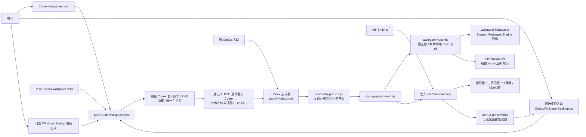

# Codex Wallpaper 架构

本文对应当前 Windows 开发候选的专用启动链路。日常 Codex 原入口不在链路内；壁纸只由专用启动器核验后加载。

## 启动链路

1. `launcher/Codex-Wallpaper.cmd`、可选 C# 桌面入口或当前用户的 Startup 快捷方式调用 `launcher/Start-CodexWallpaper.ps1`。
2. PowerShell 先取得本会话互斥锁，核对支持的 Codex 包名、应用登记、原 EXE SHA-256、日常 profile、唯一主进程和端口归属。
3. 通过官方 AUMID 冷启动 Codex，只给本次进程传入 `127.0.0.1` 上的调试端口。不替换 Codex 安装包、账号或聊天数据。
4. `launcher/startup-supervisor.mjs` 使用 `launcher/read-only-probe.mjs` 发现并核验唯一主界面，再在 25 秒恢复边界内监督目标替换。
5. `launcher/wallpaper-host.mjs` 取得端口对应的单宿主锁，建立页面绑定并处理预览与素材 File 请求。
6. `launcher/client-runtime.mjs` 被注入主界面，维护壁纸层、三页设置、快捷键、同源同步、停用与恢复。
7. Wallpaper Engine 扫描来自 `launcher/wallpaper-library.mjs`；尾置 `moov` 的 MP4 由 `launcher/mp4-layout.mjs` 生成受限虚拟布局。
8. PowerShell 收到宿主就绪回执后退出，隐藏的 Node 监督进程继续运行。Codex 完全退出后，监督进程和宿主锁结束。

## 关键源码入口

| 入口                                                                        | 责任                                             |
| --------------------------------------------------------------------------- | ------------------------------------------------ |
| [`launcher/Codex-Wallpaper.cmd`](../launcher/Codex-Wallpaper.cmd)           | 专用 CMD 入口                                    |
| [`launcher/Start-CodexWallpaper.ps1`](../launcher/Start-CodexWallpaper.ps1) | 身份核验、AUMID 激活、单实例、Startup 管理与回执 |
| [`launcher/CodexWallpaperDesktop.cs`](../launcher/CodexWallpaperDesktop.cs) | 可选 Windows GUI 与启动画面交接                  |
| [`launcher/read-only-probe.mjs`](../launcher/read-only-probe.mjs)           | 只读 CDP 发现与主界面核验                        |
| [`launcher/startup-supervisor.mjs`](../launcher/startup-supervisor.mjs)     | 目标监督、25 秒恢复、宿主握手                    |
| [`launcher/host-lock.mjs`](../launcher/host-lock.mjs)                       | 宿主锁 JSON、进程身份判定与恢复                  |
| [`launcher/wallpaper-host.mjs`](../launcher/wallpaper-host.mjs)             | 单宿主锁、页面绑定、素材交付                     |
| [`launcher/client-runtime.mjs`](../launcher/client-runtime.mjs)             | 壁纸库、设置、快捷键与同源页面设置同步           |
| [`launcher/wallpaper-library.mjs`](../launcher/wallpaper-library.mjs)       | Steam / Wallpaper Engine 发现和素材准备          |
| [`launcher/mp4-layout.mjs`](../launcher/mp4-layout.mjs)                     | 大视频 File 播放与尾置 `moov` 布局               |
| [`launcher/startup-preview.mjs`](../launcher/startup-preview.mjs)           | 可选桌面启动画面缓存                             |
| [`launcher/Reset-CodexWallpaper.ps1`](../launcher/Reset-CodexWallpaper.ps1) | 清理项目自有回执和缓存                           |

## 保护边界

- 包版本、原 EXE 摘要、应用登记、主进程创建时间、端口归属或主界面任一不匹配时，不注入并保留原界面。
- 当前发布候选只接入一个精确 `app://-/index.html` 主页面。查询路由辅助页被忽略；两个精确主页面返回 `ambiguous-main-page`，不建立页面会话、宿主锁或第二份壁纸层。同源 `storage` 只同步已注入页面的设置，不代表真实第二窗口自动获得壁纸。
- PowerShell 与 Node 通过 `launcher/host-lock.mjs` 使用同一判定：锁内 `pid` 仍存在，且该进程创建时间与锁内 `createdAt` 完全一致，才视为有效宿主；纯 PID、损坏或创建时间不匹配的旧锁可诊断并恢复。
- 单个调试端口只允许一个宿主锁；重复启动复用已核验实例，不增加第二个运行时或壁纸层。
- 退出、重启和清理只用于可丢弃的验收实例；日常 Codex profile 保持原位。

自动化、历史和本轮实机证据见[候选验收记录](planning/codex-wallpaper-candidate.md)。
