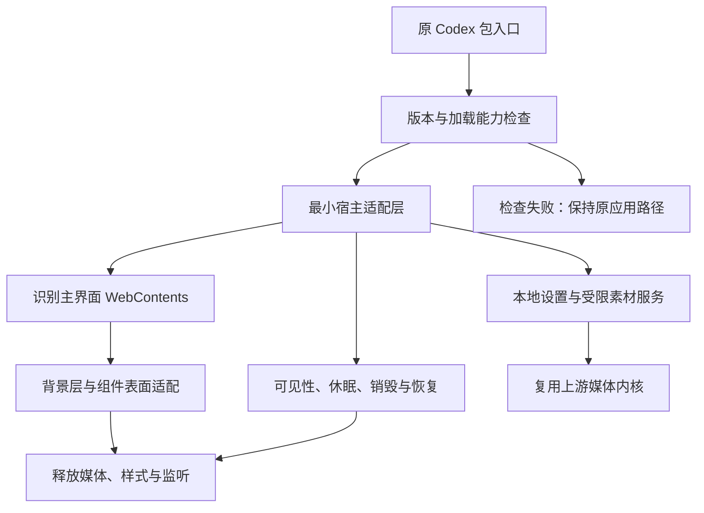

# Codex 主界面壁纸：接入方案与最小验证计划

日期：2026-11-10（Asia/Shanghai）。状态：技术提案，非已实施架构决定。需求基线为 [requirements-alignment.md](requirements-alignment.md)，验收基线为 [acceptance-matrix.md](acceptance-matrix.md)。

执行进展：同日已完成受控 P0a 实测，独立 prod 进程的主界面 CDP 与只读 WebSocket 请求通过；原入口仅观察到热激活，自动接入与冷启动仍未通过。现有工作实例未关闭，实验进程和端口已清理，缓存保留至专用 Temp 目录。详见 [codex-p0a-validation.md](codex-p0a-validation.md)。下文“未执行”等表述保留提案形成时的状态，不覆盖这份实测记录。

P0b 进展：已实测原 AUMID 向日常实例晚传 CDP 参数仍不开端口；测试 profile 内辅助程序先启动、同 profile EXE 入口复用、只读自动连接/重连和去除 CDP 参数恢复有正向证据。原注册入口 + 已登录日常 profile 的冷启动自动接入仍未通过。实验登录窗口对用户造成干扰，已停止新实例实验；现有工作实例保留，实验进程与端口清理完成。详见 [codex-p0b-validation.md](codex-p0b-validation.md)。

11 月 12 日续查：本机已升级到 `26.1106.6628.0`。本轮仅做只读检查，未启动或重启 Codex，未创建 profile。新版包含 Chromium 内建调试的相关标记，但未证明 Owl 对主界面提供该入口；上游每次连接确认的模式也不满足自动接入。P0b 门槛不变，冷启动和 P1 判据见 [续查记录](codex-p0b-cold-start-gate.md)。

## 结论先行

主界面的渲染器、背景 token、工具调用渲染分支和面板容器已经定位，具备设计宿主适配层的静态依据。当前仍没有验证通过的、保留原入口的安装接入方式；这是继续实施前的第一道门槛。

当前安装为 WindowsApps 下的 MSIX + Owl 运行时，不能把普通 Electron 的 ASAR 补丁、NODE_OPTIONS 或调试端口方法直接视为可用。微软文档说明部署后的包文件只读且受保护，改动可能导致应用无法启动。不能把成功取得文件写权限当成包完整性、启动和恢复验证通过。[Microsoft MSIX 运行说明](https://learn.microsoft.com/en-us/windows/msix/desktop/desktop-to-uwp-behind-the-scenes#installation)

建议研究顺序：先解决原入口与完整恢复，再验证一个无输入交互的背景层；接着验证现有卡片/面板与生命周期，最后接入上游四类媒体。最小验证阶段不实现壁纸商城、完整素材库、音频联动等产品功能。

公开源码中已有两个优先复查的非侵入候选：`CCDawn/Codex-Dynamic-Skin@5a0e74043b63ed9518ab37cdcf6865340a57006c` 与 `HeiGeAi/heige-codex-skin-studio@a6fa39849eaa9bf69699ab8ce1992ecf63fa675a`。它们通过自有启动脚本激活已注册应用、传入 loopback CDP 参数，再逐 renderer 注入，并非 ASAR patcher。候选 A 有旧版 Windows 的作者有限实测，候选 B 明确列出 MSIX 尚未真机验证；两者均没有本机版本实证。优先借鉴候选 A 的包身份、启动失败恢复及清理逻辑，候选 B 的严格 target 分类；先做当前 Owl 版本的受控 CDP 能力探针，再评估资源级接入。[候选 A 启动参数与失败处理](https://github.com/CCDawn/Codex-Dynamic-Skin/blob/5a0e74043b63ed9518ab37cdcf6865340a57006c/windows/scripts/start-dream-skin.ps1#L325-L382)、[候选 B 兼容范围](https://github.com/HeiGeAi/heige-codex-skin-studio/blob/a6fa39849eaa9bf69699ab8ce1992ecf63fa675a/docs/windows-compat.md#L2-L17)

两项结论必须分开：自有脚本能启动“官方二进制”，不等于“用户继续点原来的图标就自动生效”；DevTools UI/开发环境变量被门控，也不等于原生 Chromium 的 CDP 参数一定不可用。当前这两项均没有实机通过证据。

## 证据与置信范围

本机证据详见 [codex-local-source-evidence.md](codex-local-source-evidence.md)，各片段有原始成员路径、SHA-256 和字符位置。公开扩展能力与外部实现另见 [codex-extension-source-research.md](codex-extension-source-research.md)。

| 发现                                                                                                    | 源码依据                | 可以推断的范围                                                                      |
| ------------------------------------------------------------------------------------------------------- | ----------------------- | ----------------------------------------------------------------------------------- |
| 原应用入口为 `app/ChatGPT.exe`；协议、启动任务等也绑定包注册                                            | 本机 E01 / AppxManifest | 保留某个手工快捷方式不足以覆盖全部原入口；尚未验证安装方案                          |
| AppX 版本 `26.1103.4239.0`，ASAR package 版本 `26.1103.32239`，main 为 `.vite/build/early-bootstrap.js` | 本机 E02                | 确定了研究样本及主入口，不能推断可写或可注入                                        |
| 构建门控影响 Chromium 开关和 DevTools                                                                   | 本机 E03、E04           | 生产版不能照搬开发参数注入；环境覆盖会影响发行和更新策略，不能据此推荐改成 Dev 构建 |
| 主界面渲染器使用独立 preload、contextIsolation=true、nodeIntegration=false                              | 本机 E05、E08           | 应由受控宿主适配层工作，不向页面暴露通用 Node/文件系统能力                          |
| 代码支持为独立 app view 注册渲染器                                                                      | 本机 E06、E07           | 设计必须覆盖实际存在的窗口/标签页 WebContents；本机该分支是否激活未作运行证明       |
| 页面 CSP 限制脚本、frame 和 connect 来源                                                                | 本机 E09                | 上游 loopback iframe/HTTP 路由不能直接搬入宿主；须设计素材访问与隔离边界            |
| 主表面、侧栏、卡片使用主题 token 和组件类；终端、差异、嵌入内容有不同渲染方式                           | 本机 E10–E16            | 可做容器和表面适配；不能用全部背景透明的统一规则代替组件适配                        |
| 宿主使用休眠/唤醒、渲染器销毁等生命周期事件                                                             | 本机 E17、E18           | 能设计事件驱动恢复，但尚未测试壁纸暂停/恢复和所有 Owl API 行为                      |

本轮没有执行主界面注入、播放、重启、休眠、安装补丁或卸载。静态证据不替代这些运行验证。REA 的精选源码分析和完整性局限单独记在证据文件中。

## 接入路线比较

| 路线                                           | 原入口与主界面要求                                                     | 当前判断                                                                                                                                      |
| ---------------------------------------------- | ---------------------------------------------------------------------- | --------------------------------------------------------------------------------------------------------------------------------------------- |
| 官方主题/插件/MCP UI                           | 可以承担受支持的设置或独立管理入口；尚无覆盖整个主界面背景的已验证接口 | 继续按能力核查，不能把独立面板作为目标完成                                                                                                    |
| 外部辅助程序通过调试协议附加                   | 若有稳定、局部且可持久启用的传输，理论上可随原应用运行                 | 有两个公开源码候选可复用；当前主进程没有已观察到的调试启动参数，尚未验证当前 Owl 是否接受 CLI 参数；自有脚本调用 AUMID 仍未建立原图标自动闭环 |
| 原安装包加载最小宿主引导，实际适配放在用户目录 | 理论上所有原入口都可进入同一加载链                                     | 主进程/共享 preload 是代码接线候选；WindowsApps 权限、MSIX 完整性和 Owl 加载行为尚未通过，不能直接部署                                        |
| 复制为可修改的独立程序或使用专用启动器         | 可用于隔离实验                                                         | 无法单独证明保留已确认的原包入口、协议、更新和状态；实验结果不能替代原安装验收                                                                |
| 外置透明叠加窗口                               | 可以独立运行                                                           | 无法单独解决不透明宿主底色、内部面板和焦点层级问题，不能作为主界面壁纸方案                                                                    |

研究优先级是验证能否安全建立原入口加载链，而不是提前指定 ASAR 补丁为最终安装方式。如果所有满足原入口的方式都要求不可接受的包完整性破坏，结果应记录为该版本接入未通过，保留需求，不把独立网页或新启动器改称完成。

## 通过安装门槛后的适配设计

以下设计以“已取得受控的宿主接入点”为前提。它描述接线位置与责任，不证明当前包已经支持加载这些模块。

### 宿主引导与目标识别

- 传输层分两种：CDP 可用时通过外部控制器枚举和附加 renderer，窗口可见性/休眠由已绑定进程的本机控制器处理；资源级加载可用时才在主进程管理 WebContents。CDP 的 Page/Runtime 能力不等于可直接调用 Electron 主进程对象，两个分支不能混写成已经获得的能力。
- 理想引导只负责版本/散列检查、启停开关和加载受控适配模块。媒体库、配置与缓存保存在用户可写目录，不以多处修改压缩业务 chunk 作为常态更新方式。
- 主进程入口与共享 preload 是两个备选接线点。先验证主进程可管理目标 WebContents、窗口和恢复事件；若只能得到 preload 能力，必须补足原生窗口可见性、恢复和撤销通信，不能视为等价完成。
- 跟踪 WebContents 的创建、导航、页面就绪和销毁；先做 origin 与页面契约检查，再启用样式。既要处理已有实例，也要处理之后创建的实例。只监听 BrowserWindow 不足以覆盖代码支持的独立 app view。
- 对浏览器网页、认证窗口、MCP 沙箱及其他非目标载体保持边界。允许样式的范围来自已验证的页面契约，而非“所有 WebContents”。
- 保留现有 preload 和 IPC 行为；内部通用消息接口不作为可任意调用的插件 API。设置通信使用单独、窄化的通道和数据结构。

标准 Electron 的 `insertCSS` 返回可移除样式的 key，`executeJavaScriptInIsolatedWorld` 可在独立上下文工作，因此适合作为概念上的可撤销原语。Owl 下仍需在真实宿主验证方法是否支持、调用时序及导航后的行为。[Electron webContents API](https://www.electronjs.org/docs/latest/api/web-contents#contentsinsertcsscss-options)

### 背景与 Codex 界面组件

- 背景位于主界面内容下方，初始验证使用 CSS 颜色/渐变，随后使用一个本地小视频。背景默认不接收指针事件，不改动输入、滚动或文本选择的事件链。
- 以项目自己的根属性限定样式作用域，停用时移除该属性、专属 DOM 和样式 key；不改写 React 内部状态或组件实现。
- 优先围绕 `--app-color-background-surface`、`--app-color-background-surface-under` 等真实 token，以及实际 DOM 结构设计半透明表面。不能全局把所有 surface token 改成 transparent，因为代码、菜单、终端等也共享相关 token。
- `data-app-shell-*`、`data-theme`、已核查的语义容器可作为候选锚点；`data-testid` 只作为当前版本线索，不是稳定公共 API。压缩 CSS class 和父子结构均需要版本化契约与运行验证。
- 代码、diff、终端 canvas、文件/Office 编辑器保留独立实底。浏览器与 MCP guest 的内部内容不靠跨域 CSS 改写，先适配外围容器和边界。
- 在明暗主题、窗口/应用缩放、面板开合时重新计算视觉参数；不通过持续扫描整个聊天 DOM 维持背景。少量动态容器如需 MutationObserver，要限定根和解绑时机。

### 本地媒体与上游复用

上游固定研究版本为 `0c844f11fb8b2cd091931d603f316003f7cbf1dc`。复用媒体准备、WebWallGL 适配、库存和持久化模型；将 `ctx.webServer`、slots、DSH 主题变量及 `ctx.effect` 接线替换为本项目宿主适配。来源与候选模块详见 [upstream-assessment.md](upstream-assessment.md)。

- 最小层级验证只用颜色/渐变，不需要放宽页面 CSP。
- 图片/视频小样本可验证受控二进制传输与 blob URL 路径。大型视频最终需要支持流式读取和 Range，不能靠整文件塞入 IPC 或 data URL 作为正式方案。
- 场景/Web 壁纸优先评估独立来源的受限素材协议和沙箱帧；如需专用原生 WebContents，要另验证其与现有主界面的层级。父页面 CSP、帧自身 CSP、沙箱和资源读取白名单分别处理。
- 若需要增加协议或来源，只增加明确的素材来源能力；不把关闭 webSecurity、开放通用文件读取或放宽全部 CSP 作为方案。
- Web 壁纸离线默认拒绝联网；用户对某张壁纸允许联网后，访问范围限于该实例。不能复用一个携带 Codex 账户 cookie 的 session 来播放任意 Web 壁纸。
- 主动读取仅限用户配置/导入的素材根和项目元数据，不采集聊天内容。全局配置由单一写入者持久化、广播修订号，多窗口分别执行可见性与播放策略。

### 持续运行与恢复

- 运行寿命属于宿主/辅助进程及目标渲染器，不依赖聊天回合、模型请求、MCP 工具调用或当前项目。SessionStart 等会话 hook 不能代替桌面进程启动接入。
- 每个实际活动界面拥有可销毁的播放实例；隐藏标签页不累积持续播放，窗口关闭后释放实例、监听、observer 和 blob URL。
- 合并窗口最小化/隐藏、页面可见性和宿主休眠/唤醒信号。失焦不等于不可见，`isVisible()` 不单独证明完全遮挡；Windows 全遮挡判断需另验，不能提前标记通过。
- 场景/绘制层默认最高 30 FPS。视频帧率依素材与上游转码路径控制；仅限速 requestAnimationFrame 不证明视频解码已降到 30 FPS。
- 恢复时依据持久化设置重建必要资源，先检查目标仍存在及素材可读。媒体出错或 WebGL context lost 时，局部恢复、静态降级或停用壁纸；不为播放器恢复强制刷新整个 Codex。
- 重试必须有次数与时间边界，具体预算在 PoC 测量后提出。长期恢复通过事件记录评估，不以循环重试一直存在视为稳定。

## 可撤销性设计

区分三个层次，它们都需要验证：

1. **运行时停用**：停止播放/辅助服务、释放监听/observer/帧/URL、移除样式和背景节点、恢复适配器实际改动的值。不得用“重启后消失”代替当前会话停用。
2. **安装撤销**：如果采用资源级接入，只针对精确版本/散列备份并记录引导变更；验证完整恢复后原入口正常。不能在不同版本之间覆盖旧备份。
3. **更新不兼容**：运行中的适配器若检测契约变化可自行停用；新包若根本没有加载引导，则需要包外维护机制识别状态并提示。消失的引导不能承担“自己检测更新”的职责。

若采用 CDP，运行时移除壁纸不等于关闭调试通道。完整恢复要确认本轮控制器退出、loopback 端口消失，再以无调试参数的原入口启动；同时区分恢复独立实验 profile 与恢复用户日常 profile。上述候选的源码提供此恢复结构，但本机未复测。

尤其要测试引导文件存在但用户目录适配器缺失/损坏的情况：异常应被限制在壁纸加载边界。若引导在语法解析或包完整性阶段就使应用失败，普通 try/catch 无法救回，必须依赖独立恢复入口。

## 最小验证计划与停止条件

以下步骤是下一阶段的计划，本轮均未执行涉及宿主变更的步骤。数量和时长用于 PoC 证据收敛，不替代已确认的 8 小时和 7 天验收。

| 阶段                      | 最小范围                                                                                                                                                           | 通过证据                                                                                                         | 不通过时的处理                                                                                             |
| ------------------------- | ------------------------------------------------------------------------------------------------------------------------------------------------------------------ | ---------------------------------------------------------------------------------------------------------------- | ---------------------------------------------------------------------------------------------------------- |
| P0a 当前 Owl 的 CDP 能力  | 固定版本并确认进程归属；以候选的已核查 AUMID/精确包内 exe 路径，受控测试 loopback 参数及独立临时 profile；探针不改主题或用户 Codex 配置                            | 端口只监听 loopback、归属正确，发现实际主 renderer；清理实验进程与 profile，普通原入口可用且无调试端口           | 参数丢失、端口身份不符、无目标或 profile 行为异常时记为该探针未通过；不自动改环境、发行类型或 ACL          |
| P0b 原入口与安装撤销门槛  | 证明正常原图标/原注册入口无需外部手动脚本也能获得受控接入；CDP 关闭时外部 watcher 如何取得执行能力必须给出机制；如需资源级路径，先审查受保护包的完整性与可恢复部署 | 原图标冷启动的自动接入记录；确切的启动/写入范围、权限和完整恢复依据；原包保持可用                                | P0a 成功、能运行副本、自有脚本调用官方二进制、只取得文件写权限，都不能代替 P0b；原入口未通过就停止完整移植 |
| P1 空载引导与一键停用     | 无壁纸库、无联网；只显示受控标记或渐变，提供关闭入口                                                                                                               | 从用户日常的原入口冷启动 3 次；实际适用的协议/新窗口入口也测试；加载一次、关闭后样式恢复，重启恢复配置           | 记录入口、错误和恢复结果，恢复原样；不增加播放能力掩盖失败                                                 |
| P2 卡片和面板             | 同一渐变背景，逐项操作聊天、工具卡片、代码/diff、输入框、侧栏、文件/浏览器/终端、弹窗/设置                                                                         | 明暗主题、面板开合、缩放；点击/滚动/复制/选区/键盘正常，复杂内容实底保留；前后截图与操作记录                     | 锚点不稳或跨载体内容不可控时修正适配范围与契约，不能用全局透明覆盖                                         |
| P3 持续运行               | 一个小视频或受控动画；不依赖任何 agent 工作                                                                                                                        | 切换聊天/项目、新窗口和实际标签页；最小化恢复 5 次、休眠唤醒至少 1 次；短时 30–60 分钟记录实例数、内存趋势及帧率 | 重复实例、持续增长、恢复丢失或干扰 Codex 时修复本阶段；不宣称长期稳定                                      |
| P4 媒体与隔离             | 本地图片/视频/scene/web 各一个代表样本；无完整管理 UI                                                                                                              | 逐类记录原生播放/降级/不支持；断网、素材删除、未允许联网的 Web、被允许联网的 Web、播放故障各有结果               | CSP/来源/网络隔离未建立时，该类不通过；保留需求并报告差距                                                  |
| P5 故障、卸载与版本不匹配 | 停辅助服务、删除适配模块、失效配置、模拟版本/散列不匹配；不升级整机 Codex来制造测试                                                                                | 宿主可用、重试受限、可停用、能恢复原包入口；无残余播放/服务；新版本备份不被旧版本覆盖                            | 无法完整撤销或故障影响主应用则整个接入方案不通过                                                           |

P0a 的实验会改变进程运行状态并创建临时 profile，属于下一阶段的受控实验，不是只读检查；不能自动结束当前有工作的 Codex，也不能把独立会话可用当成日常会话兼容。P0a 本轮未执行。

P0b/P1 是完整移植前的最高优先级门槛。P0a 若通过，可做短暂 P1/P2 层级实验来收集 DOM/恢复证据，但仍不代表原入口通过；不投入完整产品功能。P2 与 P3 通过后才有理由投入上游四类媒体适配；P4/P5 通过后再设计完整管理功能与开展 8 小时基础验收。7 天日常观察另行开始计时，并记录实际部署版本。

## PoC 产物与资源测量

每次运行记录：AppX/ASAR/适配器版本与散列、使用的原入口、窗口/目标 WebContents 数、播放器数、样式 key 数、当前播放状态、暂停/恢复原因、故障与撤销结果。日志不记录聊天正文、账户 token 或完整文件列表。

性能测量使用相同 Codex 操作、窗口数和素材做无适配/静态背景/动态背景三组对照。记录 CPU、GPU、进程内存、播放器实例和交互响应；基于实际曲线提出预算及恢复时限，正式长时验收前确认。单独计算本机 Wallpaper Engine 本身的开销，避免把既有进程成本全部归到适配器。

当前没有 CPU/GPU/内存测量数据，不写成固定达标数字。当前最有价值的下一步是 P0/P1 的可行性验证，而不是完整播放器移植。
