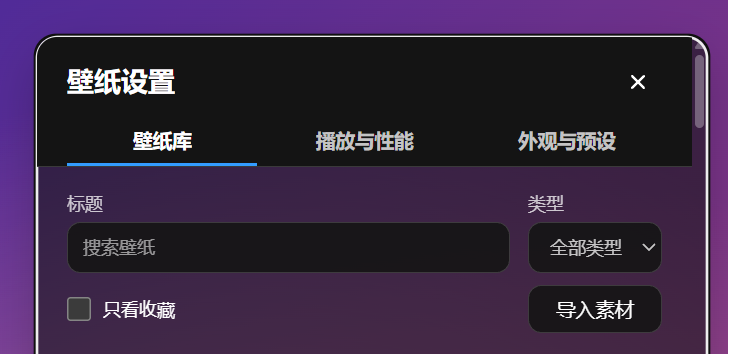
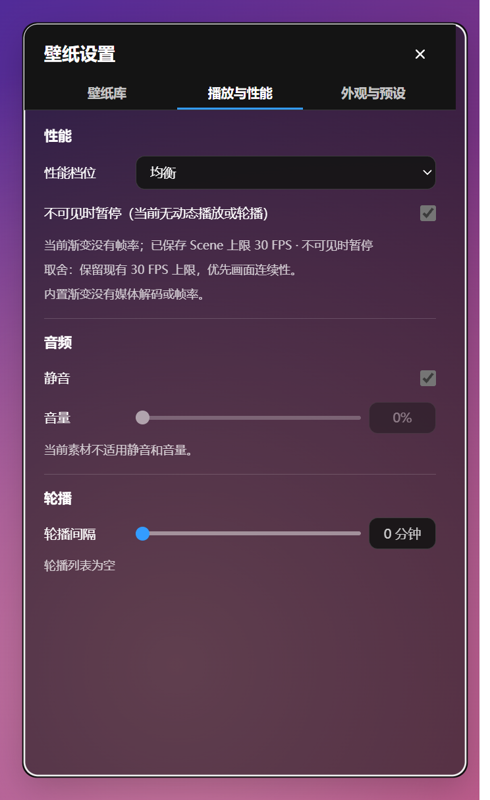
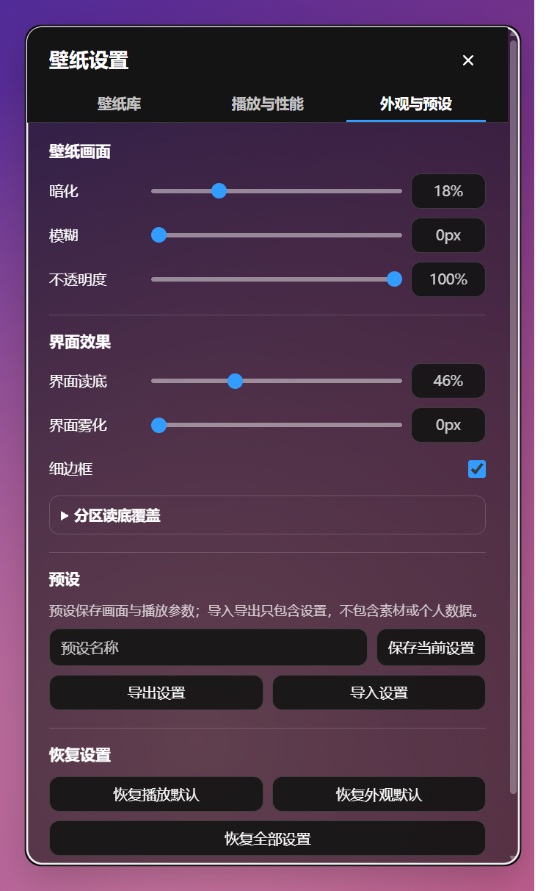

# Codex Wallpaper Windows 开发候选发布说明

> 状态：Windows 开发候选发布说明草稿，尚未打标签或发布。

## 源码快照

- 分支：`codex/release-review`
- 基线提交：`69368a46d8099437085a8f9d5985f9ddb3c53d9d`
- 本轮实现、工作流、文档和脱敏截图随当前候选提交更新。最终发布必须为该分支固定 SHA 或标签，并核验 GitHub 默认分支与已验快照一致。
- 启动器测试输入清单：`launcher/` 非 Markdown 文件、`package.json`、`pnpm-lock.yaml`，按路径排序，内容统一为 LF 后计算。
- 当前工作树清单 SHA-256（含未提交的 `launcher/Test-All.ps1`）：`9214ba41b7c47795149e677b4f2e39e7460d741ad5b0616a86d5bf91e61cb374`
- 发布前以最终标签重新计算以上值，并核验 GitHub 默认分支与已验快照一致。

源码入口、启动链路和文件职责见[架构说明](../architecture.md)。逐项证据和未覆盖项见[候选验收记录](../planning/codex-wallpaper-candidate.md)。

## 兼容范围

| 项目       | 候选范围                                                                                           |
| ---------- | -------------------------------------------------------------------------------------------------- |
| 系统       | Windows x64；最低 Windows 版本尚待矩阵验收                                                         |
| Codex      | `OpenAI.Codex_26.1111.2228.0_x64__2p2nqsd0c76g0`、`OpenAI.Codex_26.1117.3838.0_x64__2p2nqsd0c76g0` |
| 启动方式   | 官方 Codex AUMID 冷启动 + 本次环回 CDP 参数；原入口保持普通启动                                    |
| 验证工具   | Node.js `24.16.0`、pnpm `11.25.0`、Windows PowerShell `5.1`                                        |
| 浏览器夹具 | Edge `C:\Program Files (x86)\Microsoft\Edge\Application\msedge.exe`                                |
| 视频夹具   | `ffmpeg.exe`，供 `desktop-entry` 生成原生视频测试样本                                              |
| 可选素材   | 本机 Steam / Wallpaper Engine；手动图片和视频无需 Wallpaper Engine                                 |

不在范围内：其他 Codex 包名或版本、32 位/ARM64、系统级安装器、替换原快捷方式、联网 Web 壁纸。

## 发布检查

在仓库根目录安装锁定依赖并运行唯一聚合入口：

```powershell
pnpm.cmd install --frozen-lockfile
pnpm.cmd test:full
```

该入口串行执行 Node 测试和四个 Windows PowerShell 夹具，输出名称、耗时和退出码；Edge、ffmpeg 或 PowerShell COM 缺失时标记 `BLOCKED` 并以非零退出。只调试 Node 测试时使用 `pnpm.cmd test`。

## 安装与启动

1. 先从官方入口完成 Codex 初始化和登录，确认已有聊天可用，再完全退出 Codex。
2. 安装锁定依赖：

   ```powershell
   pnpm.cmd install --frozen-lockfile
   ```

3. 从仓库根目录运行：

   ```powershell
   .\launcher\Codex-Wallpaper.cmd
   ```

4. 只有出现 `Outcome: wallpaper-ready` 才表示主界面已核验且宿主已就绪。若壁纸偏好为停用，`Wallpaper` 可为 `disabled`，按 `Alt+Shift+W` 恢复。

登录启动入口只创建当前用户 Startup 文件夹中的一个快捷方式：

```powershell
powershell.exe -NoProfile -STA -File .\launcher\Start-CodexWallpaper.ps1 -EnableStartup
```

## 发布截图

截图来自本轮 P1 运行时 `12b9053bf3c54bcfbc41ef9a12564941dcd167a43476a233a6205b13a026fd2e`，在真实 x64 Codex `26.1117.3838.0` 页面临时加载后捕获，随后已恢复原运行时 `c7355d16dec52cb05dbd5b0c34383134b4298d570f07a1e84c7677a548f171f2` 和逐字节一致的配置。

公开图只使用候选内置渐变。账号、聊天、本机路径、Wallpaper Engine 缩略图和标题均未进入公开图；库页只保留标题、筛选和导入入口。未使用第三方壁纸素材。








## 本轮验收摘要

| 范围            | 结果                                                                                                                                                                                                                                             |
| --------------- | ------------------------------------------------------------------------------------------------------------------------------------------------------------------------------------------------------------------------------------------------ |
| 07 宿主锁       | Node 7/7、启动根 PowerShell 夹具 4/4；真实持锁、原宿主退出、PID 复用、过期锁恢复通过                                                                                                                                                             |
| 08 Windows CI   | 工作流已收敛为单一 `pnpm.cmd test:full` 入口；本地 Node 74/74、四个 PowerShell 夹具通过。新入口在 GitHub 托管 runner 的实跑待推送；[运行 44914154099](https://github.com/ye-chiyo/codex-wallpaper/actions/runs/44914154099) 只代表此前内联双入口 |
| 09 真实宿主兼容 | 独立测试环境尚未就绪；目标替换、多窗口、主题/DPI、登录启动和 GUI 交接待实机                                                                                                                                                                      |
| 10 媒体性能     | P1 运行时真实页面热切：前置 `moov` 20/20、p95 294.9 ms、最大 298.9 ms；尾置 `moov` 20/20、p95 293.4 ms、最大 325.2 ms；均低于 300/500 ms 门槛                                                                                                    |
| 10 长期资源     | Scene/离线 Web、冷启动 T0–T7、30–60 分钟对照、8 小时和 7 天观察仍待验                                                                                                                                                                            |
| 11 发布材料     | 架构图、脱敏截图和本说明已就绪；最终提交 SHA、GitHub 默认分支和发布授权仍待处理                                                                                                                                                                  |

## 已知限制

- 原 Codex 入口不能自动加载壁纸，必须使用专用启动器。
- 真实主界面目标替换、多窗口、明暗主题、DPI、登录/注销/重启和可选 GUI 的完整矩阵尚未完成。
- 不支持联网 Web 壁纸；离线 Web 不执行页面脚本，也不加载外部资源。
- Wallpaper Engine 兼容率必须逐素材验收；Scene 实际帧率、GPU 和功耗仍需独立测量。
- 30–60 分钟资源对照、8 小时连续使用和 7 天日常观察未完成。
- 当前截图是 P1 运行时临时注入的真实页面，不等同于同一快照的完整冷启动验收。

## 停用与撤销

1. 临时停用：在 Codex 窗口按 `Alt+Shift+W`；再次按下恢复上次选择。
2. 清除页内数据：在「外观与预设」执行两次确认的「停用并清除本项目数据」。
3. 撤销登录启动：

   ```powershell
   powershell.exe -NoProfile -STA -File .\launcher\Start-CodexWallpaper.ps1 -DisableStartup
   powershell.exe -NoProfile -STA -File .\launcher\Start-CodexWallpaper.ps1 -StartupStatus
   ```

4. 完全退出专用 Codex，运行：

   ```powershell
   .\launcher\Reset-CodexWallpaper.cmd
   ```

5. 从 Windows 开始菜单的官方入口重新打开 Codex，确认原账号和已有聊天可用。

源码回退以基线提交 `69368a4` 或最终发布提交为准；本项目不修改 Codex 安装包，因此不需要恢复 Codex 系统文件。

## 来源与许可

- 自有源码公开供阅读和参考，但仓库未授予自有代码的一般性复用许可。
- Wallpaper Engine 扫描复用固定 MIT 上游，见[第三方通知](../../launcher/vendor/THIRD_PARTY_NOTICES.md)。
- Scene 依赖 MIT 许可的 `webwallgl@3.0.0`。
- 公开截图只含项目内置渐变；未分发 Wallpaper Engine 或创意工坊素材。
